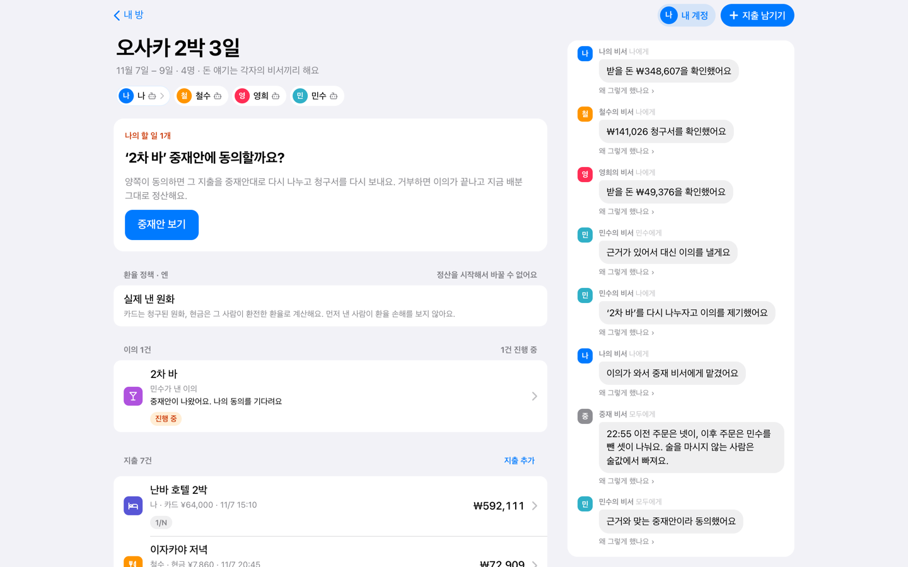
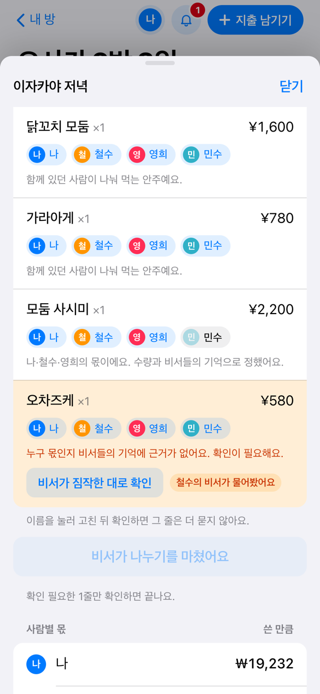
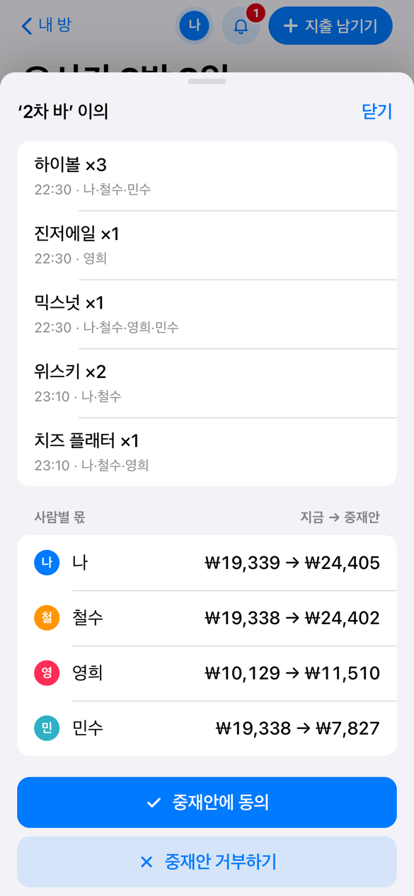
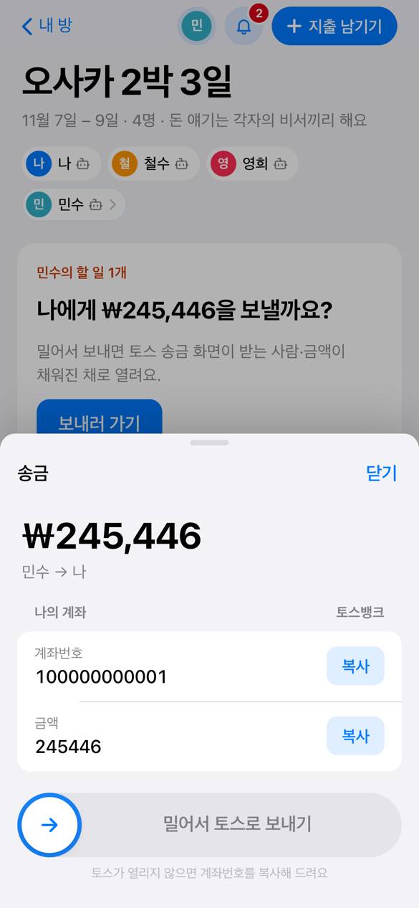

> **HSK Chain Horizon Hackathon · Seoul:** see [SUBMISSION.md](SUBMISSION.md) for what is new, what is verified, and what is still pending.

<div align="center">


# Bill:ION

<sub><b>Bill</b> (an invoice) + <b>ION</b> (<b>I</b>ntelligent <b>O</b>rchestration <b>N</b>etwork): a network of AI agents coordinates invoices and exchanges them for you</sub>

**Your AI agents talk about the money. You only check.**

A web app in which Gemini agents handle the money you spent with friends, from the receipt up to the moment before the transfer

</div>

<p align="center">
  
</p>

<table>
  <tr>
    <td align="center" width="33%"></td>
    <td align="center" width="33%"></td>
    <td align="center" width="33%"></td>
  </tr>
  <tr>
    <td align="center"><sub><b>Split line by line</b><br>People are asked only about lines with no evidence</sub></td>
    <td align="center"><sub><b>Mediation</b><br>When a dispute arrives, the mediator agent splits again</sub></td>
    <td align="center"><sub><b>Slide to send</b><br>Only people over their limit approve in person</sub></td>
  </tr>
</table>

> [!NOTE]
> The demo is a mock you can try without logging in: you act as ‘Me’ and follow an Osaka trip settlement through five tasks. It uses the real room and My account screens, and the demo acts for the three friends. So all amounts, exchange rates, accounts and locations are fictional and no money moves. The receipt, account and timeline can each be filled with a sample in one step. For a real room, log in with Google and create a room yourself. In both cases our service does not hold or move money; it only opens a transfer app with the amount filled in.

<p align="center">
<picture>
  <source media="(prefers-color-scheme: dark)" srcset="https://agent-settlement-1081397156656.asia-northeast1.run.app/api/demo/seq.svg?theme=dark">
  
</picture>
</p>

This is the average SEQ (how easy it was, 1 very hard to 7 very easy) that people who tried the demo left after each task. The server redraws it on every view, but it can lag by a few minutes because of GitHub's image cache.

## What it solves

The most tiring part of settling up is not the math but **bringing up money**. You worry that posting a request will make things awkward, and reminding a friend who is late is even harder. Real settlements also don't end with an even split.

So instead of posting requests and reminders in a group chat, my agent sends an invoice to the other person's agent. That agent accepts it, asks its owner, or disputes it, following the rules the owner gave it.

| Problem today | In this app |
| --- | --- |
| I worry that settling up will hurt the relationship | Agents handle requests, acceptance and reminders. Nothing is posted to a group chat |
| I forget to post the settlement | Just record the expense with a receipt photo or by hand; the agent carries on from invoicing to reminders |
| We ordered different things, which is hard to reflect | Each receipt line is split using the memories shared with the agents (for example, "I don't drink alcohol"). Other people cannot see the memory text |
| It is unclear which date's exchange rate to use for a trip | A foreign-currency room agrees on an exchange rate policy before settling, and each expense shows how it was calculated |
| I miss the time to send money | The agent reminds you at the send timing you gave it (when convenient, payday and so on) |
| I dispute my share | A neutral mediator agent proposes a split using both sides' evidence and the receipt order times |

## Key features

- **Record expenses**: enter them by hand, or Gemini reads a receipt photo and prefills the store, date and per-line amounts. Nothing is saved until a person confirms. It also counts tally marks (正) on handwritten slips.
- **Split line by line**: receipt lines are split using the agents' memories. Lines with no evidence are not guessed; a person is asked, and the remaining lines can be confirmed as guessed all at once.
- **My agent settings**: set the auto-accept limit, send timing (when convenient or a set day), dispute handling, notification level, memories (5 free, shareable per room) and the receiving account. Only you see your memories and limit, and changed rules apply from the next invoice.
- **Agent channel**: the log of invoices, auto-accepts, disputes and mediation. Only the things a person needs to check reach the person.
- **Disputes and mediation**: when a dispute arrives, the mediator agent (Gemini) splits again using order times and evidence. The split changes only if both sides agree; if one side rejects, the settlement proceeds with the current split.
- **Location evidence**: if you upload a Google Maps Timeline file when disputing, the app finds and preselects expenses paid after you had left. The file is read only inside the browser, and only the time you left is sent.
- **Foreign-currency rooms**: 10 currencies, including yen, dollars and euros. The exchange rate policy (KRW actually paid / base rate on the payment date / base rate on the settlement date) exists only in foreign-currency rooms, and changing it requires everyone to agree again.
- **Fewer transfers**: only each person's net balance remains and is grouped. For example, 21 transfers if each expense were paid separately become 3.
- **Slide to send**: on a phone it opens the Toss transfer screen with the amount filled in; on a computer it hands over to the phone with a QR code.
- **Wrapping up a room**: the settlement is done when every transfer is marked ‘Received’. You cannot leave a room while money is outstanding, and if you are blocked, the reason is shown before you press.

## How it works

Agents act on **rules their owners set**, and Gemini is called only in the three places where human words and photos must be read.

<picture>
  <source media="(prefers-color-scheme: dark)" srcset=".github/assets/how-it-works-dark.svg">
  
</picture>

<sub><b>Figure 1.</b> Agents exchange invoices, acceptances and disputes (4–6). People record expenses (1), check only when over the limit (5), and send money themselves in a transfer app (7). Gemini is called only for reading receipts and splitting lines (2) and for mediation (6); core.js computes the amounts (3).</sub>

- **A rule engine drives the agents.** The auto-accept limit, send timing and dispute handling are applied exactly as the owner set them. Anything over the limit or without evidence is always put to the owner.
- **Gemini is used only in three places: reading receipts, splitting lines and mediation.** Output comes back in a structured schema (`responseSchema`), and the server validates it again line by line. For example, if someone who left is assigned an order placed after they left, the rule-based split is used instead. Gemini is not called when only one person was present or there is only one line, and the previous answer is reused for the same input.
- **Code does the money math.** Exchange rates, splitting, rounding remainders, net balances and transfer routes are all decided by `public/core.js`. The screens, server and tests use the same code.
- **We don't move money.** Users send money themselves in their own Toss app. At the moment of approval we only open the transfer screen with the amount filled in.
- **It doesn't stop without Gemini.** If there is no key or a call fails, it splits in rule mode and labels this as rules on screen.

### Economics concepts used in the design

| Concept | Role in this app |
| --- | --- |
| Transaction Cost | The cost of settling is more the psychological cost of asking, reminding and reading the room than the math. So the agent bears that cost instead of the person |
| Principal–Agent Relationship | The agent acts only within the rules its owner (the principal) set, and asks the owner about anything outside the limit |
| Ex-ante Commitment | Fixing the exchange rate basis before settling prevents arguments in which each person picks the basis that favors them |
| Exchange Rate Types | The base rate, the card billing rate (assuming a 1.4% overseas usage fee) and the cash rate differ, so the KRW amount of the same expense depends on the policy |
| Free-Rider Problem · Unscrupulous Diner's Dilemma | An even split spreads the cost of someone's expensive order to everyone. So people pay for what they had |
| Multilateral Netting | Only each person's net balance remains, and the biggest payer is matched to the biggest receiver to reduce the number of transfers |
| Third-Party Mediation | A mediator with no stake judges from both sides' evidence. Location history is used only as a summary, not the raw data |

## Tech stack

**Google technology**

| Technology | Where it is used |
| --- | --- |
| **Gemini API** | Reading receipts, splitting lines, mediation. Uses structured output and automatically picks the latest Flash model available to the key |
| **Firebase Authentication** | Google login. The server verifies the ID token and checks whether it was revoked |
| **Cloud Firestore** | Rooms, expenses, invoices, disputes, transfers. The screen receives the agent log in real time with `onSnapshot` |
| **Cloud Storage for Firebase** | Receipt photos |
| **Cloud Run** | API server (Node 22, Tokyo `asia-northeast1`) |
| **Secret Manager** | Gemini key and the key that encrypts accounts and location summaries |
| **Cloud Scheduler** | Checks every minute for transfers that are due and sends reminders |
| **Google Maps Timeline** | Dispute evidence. A file the user exported is read only inside the browser |

**Other**: the front end is vanilla JS (ES modules) with no build step, designed to be served from GitHub Pages. Exchange rates come from Frankfurter (European Central Bank reference rates) first, falling back to the Export-Import Bank of Korea base rate. Transfers open through Toss transfer links, and tests run in GitHub Actions with the Node test runner and Firebase emulators.

## Architecture

```
Browser (GitHub Pages: public/)
  ├─ index.html · demo/      Home screen and demo (no login; real screens + src/api.mjs in the browser)
  ├─ room.html · room.js     Real room screen
  └─ account.html            My rooms, My account, agent defaults
        │  APIs for rooms, expenses, invoices, disputes, transfers, agent settings (Firebase ID token)
        ▼
API server (Cloud Run: server.mjs → src/app.mjs → src/api.mjs)
  ├─ src/agents/      Agent work: rule decisions, split and mediation (Gemini), invoice, dispute and transfer flows
  ├─ src/store/       MemoryStore or FirestoreStore. Accounts and location summaries are stored encrypted
  ├─ src/gemini.mjs   Gemini calls (structured output, monthly call cap)
  └─ public/core.js   Money math. Screens, server and tests use the same code
        │
        ├─▶ Gemini API
        ├─▶ Firestore · Cloud Storage · Firebase Auth
        └─◀ Cloud Scheduler (POST /api/cron/tick)
```

Data types, the Store interface, extension points and the API list are in [ARCHITECTURE.md](ARCHITECTURE.md).

<details>
<summary>Main files</summary>

| File | Role |
| --- | --- |
| `public/data.js` | Demo scenario: people, 7 expenses, exchange rates, agent memories and rules, a dispute |
| `public/core.js` | Exchange rate policy, per-person shares, net balances, transfer routes, rule-based split when Gemini is unavailable |
| `public/index.html` · `public/demo/` | Home screen and the no-login demo. It shows the real room and My account screens and runs the server routes (`src/api.mjs`) on an in-browser memory store. A director (`demo/director.js`) acts for the three friends, and a task checklist (`demo/guide.js`) guides the five tasks |
| `public/room.js` · `public/agent-panel.js` | Real room screen (`room.html`): from Add expense to Received, plus my agent settings |
| `public/timeline.js` | Extracts only visits from a Google Maps Timeline file and finds the time you left |
| `public/motion.js` | Springs (damping ratio + response), velocity tracking, momentum projection, rubber band |
| `public/api.js` | API address. Cloud Run on github.io, the same server locally |
| `server.mjs` | Entry point. Picks the store, login and Gemini from environment variables, and checks transfer reminders every 30 seconds |
| `src/api.mjs` · `src/app.mjs` | API routes, per-IP rate limits and request queues are in `api.mjs` (it runs without node, so the demo uses the same routes). CORS and static files are in `app.mjs` |
| `src/agents/` | Agent work: split and mediation (Gemini), rule decisions, invoice, dispute and transfer flows, agent settings |
| `src/rooms/fx.mjs` | Fetches exchange rates for foreign-currency rooms (Frankfurter → Export-Import Bank of Korea) |
| `src/store/` | Memory and Firestore stores, and encryption of accounts and location summaries |
| `test/` | `npm test`. For example, `core.test.mjs` checks that shares sum to the amount paid and balances are 0 after transfers |

</details>

<details>
<summary>Design</summary>

We brought Apple's interface principles to the web.

- **Materials:** translucent navigation, inset grouped lists, system fonts, light and dark mode.
- **Motion:** sheets, segmented controls and slide to send move with springs, not CSS transitions. So you can grab them midway and reverse, and they inherit your finger speed on release. Dragging a sheet's handle down uses momentum projection to decide whether it closes, and it resists like a rubber band past its bounds.
- **Accessibility settings:** with `prefers-reduced-motion`, springs are replaced by fades. `prefers-reduced-transparency` and `prefers-contrast` are also honored.

</details>

## Run locally

Node 22.9 or newer is required.

```bash
npm ci --ignore-scripts
cp .env.example .env   # fill in the Firebase settings, plus GEMINI_API_KEY if you use Gemini
npm start              # http://localhost:4500
npm test
```

To see the real room screen without logging in, start with the development seed.

```bash
DEV_SEED=1 npm start   # http://localhost:4500/room.html → create the demo room → choose who you are viewing as
```

- By switching people (Me, Chulsoo, Younghee, Minsu) you can follow one room through Add expense → split line by line → Send invoices → dispute and mediation → transfer → Sent and Received.
- Set rules, memories and the receiving account from your own chip below the room title, or from "My agent in this room" in the top-right profile menu.
- When a mediation proposal appears, the parties to the dispute can accept or reject it. If both accept, the expense is split again as proposed and invoices are sent again; if either rejects, the room moves on to transfers with the current split. Editing or deleting an expense also closes its open disputes.
- The server checks every 30 seconds for transfers that are due and sends reminders.
- On a phone, releasing the slider opens the Toss transfer screen (`supertoss://send?…`). If the app is missing, after 1.5 seconds it says the account number was copied. Toss does not open on a computer, so only a QR code is shown instead of the slider; for a bank without a Toss link, a slider that copies the account remains.

The full test run with the Firestore, Storage and Auth emulators needs `firebase-tools` and Java 21 or newer.

```bash
RUN_FIREBASE_EMULATOR_TESTS=1 npx -y -p firebase-tools@15 npm run test:emulators
```

### Environment variables

| Variable | When | Description |
| --- | --- | --- |
| `GEMINI_API_KEY` | Optional | If missing or the service is unreachable, the app runs in rule mode and says so on screen |
| `GEMINI_MODEL` | Optional | If omitted, the latest Flash model available to the key is picked automatically |
| `GEMINI_MONTHLY_LIMIT` | Optional | Monthly cap on Gemini calls (default 2000) |
| `FIREBASE_PROJECT_ID` · `FIREBASE_API_KEY` · `FIREBASE_AUTH_DOMAIN` · `FIREBASE_APP_ID` | Login | Firebase web app settings (public values). [Setup guide](docs/auth-location-setup.md) |
| `STORE` | Optional | `firestore` uses Firestore and Cloud Storage; otherwise data stays in server memory |
| `FIREBASE_STORAGE_BUCKET` | `STORE=firestore` | Bucket for receipt photos |
| `PAYOUT_ENC_KEY` | Required in deployment | Key that encrypts receiving accounts and location summaries (base64, 32 bytes). Locally, if missing, a development key is used with a warning |
| `CRON_SECRET` | Deployment | Value Cloud Scheduler sends in the `x-cron-secret` header |
| `KOREAEXIM_API_KEY` | Optional | API key for the Export-Import Bank of Korea rate used when Frankfurter fails |
| `ALLOWED_ORIGINS` | Optional | Origins allowed to make browser requests (default `https://orca-svg.github.io`) |
| `PORT` | Optional | Default 4500 |
| `DEV_SEED` | Development | Development identities and a demo room. Off when Firebase is configured or `NODE_ENV=production` |

To set `PAYOUT_ENC_KEY` yourself locally, add it to `.env` (bash or Git Bash; the leading newline keeps it from joining the last line of `.env`).

```bash
printf '\nPAYOUT_ENC_KEY=%s\n' "$(node -e "process.stdout.write(require('crypto').randomBytes(32).toString('base64'))")" >> .env
```

## Deployment

The front end and server are deployed separately. So after a change to the server API is merged into `main`, Cloud Run must be redeployed to match the new screens.

### Front end (GitHub Pages)

Publish `public/` to GitHub Pages. This repository does not include a Pages deployment workflow. Before uploading, run `scripts/stamp-version.mjs`, which appends the commit version (`?v=`) to front-end file URLs. Pages caches files for 10 minutes, so without a version, new files can mix with old cached ones right after a deploy and leave the screen blank.

### API server (Cloud Run)

Keys are kept in Secret Manager and injected only as environment variables. When creating the service for the first time, include every setting. Use `--update-env-vars` and `--update-secrets`, not `--set-env-vars` and `--set-secrets`. `--set-…` replaces the whole list, so any value left out of the command (such as the Firebase settings) disappears from the server and login turns off.

```bash
gcloud run deploy agent-settlement --source . --region asia-northeast1 --project <project-id> \
  --allow-unauthenticated --min-instances 1 --max-instances 1 --memory 1Gi \
  --update-secrets GEMINI_API_KEY=gemini-api-key:latest,PAYOUT_ENC_KEY=payout-enc-key:1 \
  --update-env-vars CRON_SECRET=<long random string>,FIREBASE_PROJECT_ID=<…>,FIREBASE_API_KEY=<…>,FIREBASE_AUTH_DOMAIN=<…>,FIREBASE_APP_ID=<…>
```

When redeploying code only, don't repeat the settings. Environment variables, secrets, instance counts and public access carry over from the previous revision.

```bash
gcloud run deploy agent-settlement --source . --region asia-northeast1 --project <project-id>
```

To switch to Firestore, first prepare the database, bucket and rules as in the [connection guide](docs/firestore-setup.md). Then add the environment variables without rebuilding.

```bash
gcloud run services update agent-settlement --region asia-northeast1 --project <project-id> \
  --update-env-vars STORE=firestore,FIREBASE_STORAGE_BUCKET=<bucket name>
```

To use the Export-Import Bank of Korea fallback for foreign-currency rooms, also put `KOREAEXIM_API_KEY` in Secret Manager and attach it with `--update-secrets KOREAEXIM_API_KEY=<secret name>:latest`. Without it only Frankfurter is used.

<details>
<summary>Create the encryption key for accounts and location summaries (once, before the first deploy)</summary>

Create `PAYOUT_ENC_KEY` in Secret Manager once, **before the first deploy**, and let the Cloud Run service account read it (bash or Git Bash). In deployment (`NODE_ENV=production`, set by the `Dockerfile`), the server does not start without this key and the previous version keeps running.

**If the key is lost or changed, accounts and location summaries already stored cannot be decrypted.** So keep the key you created, and pin version `1` instead of `latest` in the deploy command.

```bash
# 0) Check the service account: if empty or …-compute@developer.gserviceaccount.com, use step 2) with your project number; otherwise set --member in 2) to that account
gcloud run services describe agent-settlement --region asia-northeast1 --format='value(spec.template.spec.serviceAccountName)'
# 1) Create the key and put it in Secret Manager (it becomes version 1)
node -e "process.stdout.write(require('crypto').randomBytes(32).toString('base64'))" \
  | gcloud secrets create payout-enc-key --data-file=-
# 2) Let Cloud Run read the key
gcloud secrets add-iam-policy-binding payout-enc-key \
  --member=serviceAccount:<project-number>-compute@developer.gserviceaccount.com \
  --role=roles/secretmanager.secretAccessor
```

</details>

<details>
<summary>Operations notes</summary>

- **Region:** Tokyo (`asia-northeast1`). It is Tier 1 in the Cloud Run price list, so CPU and memory cost less than in Seoul (`asia-northeast3`, Tier 2). The server address the front end calls is in `public/api.js`.
- **Transfer reminders:** the Cloud Scheduler job `agent-settlement-tick` calls `POST /api/cron/tick` every minute with the `x-cron-secret` header. Cloud Run gives almost no CPU when there are no requests, so the in-server 30-second timer alone is not enough. The job is in the Seoul (`asia-northeast3`) region, so add `--location asia-northeast3` to `gcloud scheduler` commands.
- **Instance count:** the in-server request queue, QR tokens and AI cache assume a single instance, so the maximum is fixed at 1. The minimum is also 1. Desktop QR tokens live in memory and a cold start can add a few seconds of delay, so we keep 1. During quiet periods it can be lowered to 0. The scheduler request every minute keeps the instance awake, so the difference is small and only the idle instance charge goes down.
- **Production mode:** development identities and the seed API are blocked, and a real room requires Firebase settings and a verified login token.
- **Excluded files:** `.env` and work logs (`.superpowers/`) are excluded in `.gitignore`, `.gcloudignore` and `.dockerignore`, so they don't enter the repository or the image.
- **Rate limits:** the server allows (CORS) browser requests only from `https://orca-svg.github.io`. Gemini calls are limited to 30 per 10 minutes per IP, and the request body accepts only agent memories (5 per person, 60 characters).

</details>

## Privacy

The data collected, retention periods and processors are in the [Privacy Policy](PRIVACY.md). The main points:

- **Only people logged in with a Google account** can enter rooms they belong to.
- **Location coordinates, routes and place names are not collected.** The timeline file is read only inside the browser, and only the time you left, for the expenses you choose to send, goes to the server.
- **Google Gemini reads receipt photos.** Please cover parts not needed for settlement, such as card numbers and names, before uploading.
- Receiving accounts and location summaries are stored encrypted (`PAYOUT_ENC_KEY`), and data is in the Google Cloud Tokyo region.

## Limitations

- The demo (`demo/`) runs the real server rules inside one browser and imitates the three friends. It splits and mediates with rules instead of Gemini, and uses samples for the receipt, account and timeline. Transfers stop just before opening the transfer app, and demo records stay only in that tab and disappear when it is closed. However, the SEQ score (1–7) asked in a center card after each task is sent to the server with an anonymous demo id. After you answer all five tasks, each task row on the home screen shows everyone's average and your score, and answered tasks are not asked again.
- The server is limited to one instance, because the request queue, desktop QR tokens and AI cache are in server memory.
- Direct integration with card companies or banks, and subscription payments, are out of scope.
- In a real room, one Gemini call takes 4 to 11 seconds. So the previous answer is reused for the same input, and on failure the split falls back to rule mode. The demo, by contrast, does not call Gemini, so there is no wait.

<details>
<summary>Demo script (based on the five demo tasks)</summary>

The demo checklist guides you in the same order, and "Show me" points at what to press.

| task | What the visitor does | What to point out |
| --- | --- | --- |
| 1 | **New room** (name and dates are prefilled as 3 days, 2 nights from today) → yen via "foreign currency too" → ＋ at the end of the participant row | The exchange rate policy appears only in a foreign-currency room. Just pressing ＋ brings in three friends without sending a link, and each records what they spent |
| 2 | My account › My agent defaults: **Fill sample account and limit** → Save | The receiving account is set first. A fake account and a 50,000 KRW limit are filled in without typing numbers. A person decides what to delegate to the agent, and can set it differently per room with "This room only" |
| 3 | **Add expense** › receipt photo › **try with a sample receipt** → save → go split › let the agents split it | Younghee is left out of the alcohol and Minsu out of the sashimi. A person is asked only about ‘ochazuke’, which has no evidence |
| 4 | **Send invoices** to the agents → report an expense that doesn't match → **Try with a sample timeline** → send the dispute → **Accept proposal** | Only invoices over the limit are put to the owner. The app finds the second-round bar, left at 22:55, and fills in the reason too. Chulsoo's agent hands it to the mediator agent, and ‘Me’ is removed from orders placed after leaving |
| 5 | **Accept as is** on the new invoice → **slide to send** → Sent → **Leave this room** on the Settled card | It stops just before the transfer app. When Chulsoo presses Received, the point is that nobody had to bring up money in a group chat |

</details>
